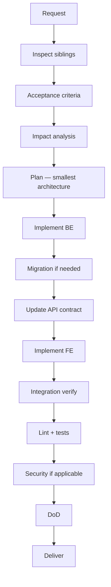

# Feature Implementation Workflow

Use for significant new product capabilities (not one-line fixes).

## Trigger

User asks to build a feature, product slice, or capability spanning one or more domains.

## Do Not Use For

- Isolated bug fixes → `BugFix.md`
- Pure refactors → `Refactor.md`
- CSS-only tweaks → skip most gates; use FrontendUIQuality skill lightly

## Flow

```
User Request
    → Understand / Inspect Existing System
    → Define Acceptance Criteria
    → Impact Analysis
    → Architecture / Technical Plan (YAGNI)
    → Identify Required Domains
    → Implement (backend → DB → API contract → frontend → tests)
    → Cross-Domain Integration
    → Quality Gates
    → Definition of Done
    → DELIVER with evidence
```



## Steps

### 1. Inspect existing system

- Read `project-context/PROJECT_CONTEXT.md` and `COMMANDS.md`.
- Find a sibling feature. Mirror layout, naming, DI, serializers, tests.
- Do not invent a parallel style.

### 2. Acceptance criteria

Write 3–8 testable criteria. Example:

- Authenticated user can GET/PUT their profile.
- Other users cannot access this profile (403).
- Validation errors return the project's existing error shape.
- Empty avatar state is handled in UI.

### 3. Impact analysis

Load `skills/impact-analysis/ImpactAnalysisSkill.md`. List files, contracts, tests, docs.

### 4. Implementation order

1. Domain/data (models, repos, migrations)
2. Application (services/use cases)
3. Presentation (views, serializers, schemas)
4. Wire URLs + DI
5. Service tests
6. Frontend types/client from contract
7. UI screens with loading/empty/error states
8. Integration verification

### 5. Verification loop

```
IMPLEMENT → VERIFY → FIND ISSUES → FIX → REVERIFY → GATES → DELIVER
```

Max 3 retry cycles. Then BLOCKED.

### 6. Skills to load

- Backend overlay if Django/Python
- API engineer + contract integrity if API involved
- Frontend UI + UI design + a11y if UI involved
- Migration review if schema changes
- AppSec if auth/user data

## Completion

DoD from `quality-gates/DefinitionOfDone.md` for applicable domains. Original requirement vs implementation check last.
