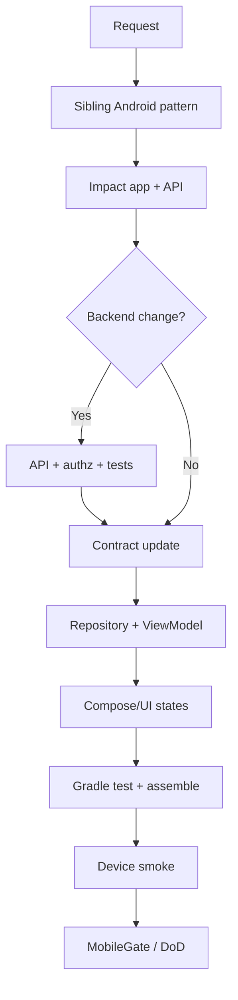

# Mobile / Android Feature Workflow

Use for Android app features (accounts, lists, forms, settings) that may include backend work.

## Trigger

User asks to build or change an Android app feature, screen, or client+API slice.

## Do Not Use For

- Pure gameplay systems → `MobileGameFeature.md`
- Web-only UI → `FrontendUIFeature.md`

## Flow

```
Inspect sibling Android feature
    → Acceptance criteria (phone + offline/error)
    → Impact: app modules + backend + contract
    → Backend (if needed) with mobile-backend-api rules
    → Update OpenAPI / client DTOs
    → Data layer → ViewModel → UI
    → Unit tests + assembleDebug
    → Emulator/device smoke
    → MobileGate + DoD
```



## Skills

`android-app`, `android-kotlin` overlay, `mobile-api-client`, `mobile-ui-ux`, `mobile-testing`, `mobile-backend-api` (if API), `contract-integrity`, `mobile-security` (if auth/data)

## Completion

See `quality-gates/MobileGate.md` and Definition of Done mobile section.
