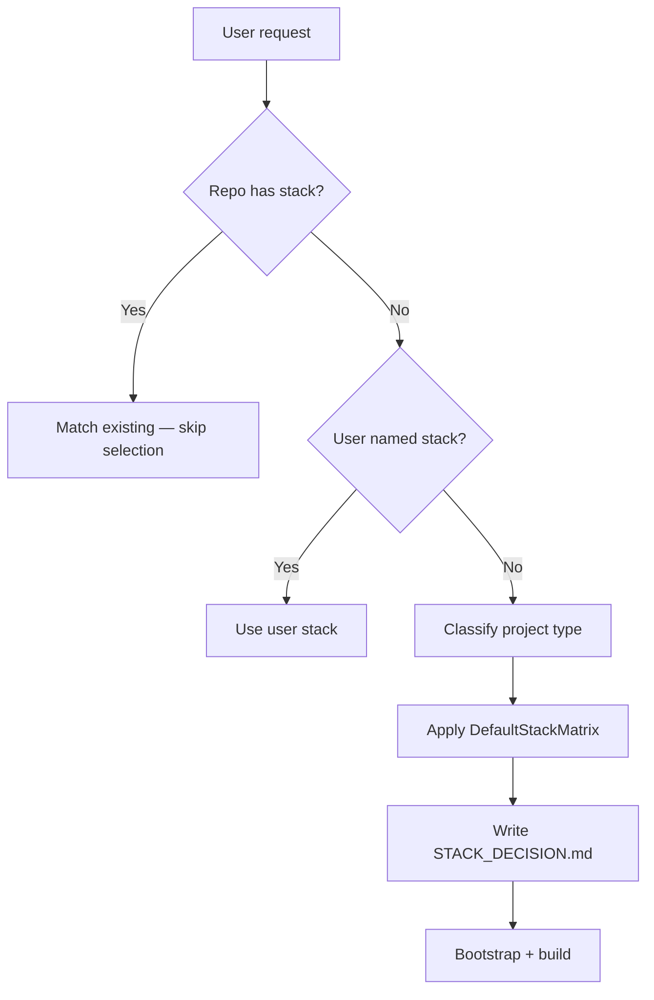

# Stack Selection Workflow

Use when starting a **new** product or when the user asks to build something **without naming** language/framework.

## Trigger

- Empty / new repository
- “Build a web app / game / LLM product / API” with no stack
- Bootstrap detects no stack

## Do Not Use

- Repo already clearly Django, Next, Android, Unity, etc. → match siblings
- User already specified stack

## Flow

```
Classify project type (web / mobile / game / LLM / …)
    → Load stack-selection skill + DefaultStackMatrix
    → Announce decision + rationale + override offer
    → Write STACK_DECISION.md + PROJECT_CONTEXT stack fields
    → NewProjectBootstrap (adapters, Docker if needed)
    → Implement with matching domain skills
```



## One clarifying question (only if needed)

> Is this mainly a **web app**, **Android/mobile game**, or **LLM/RAG product**?

Do not present a long menu of frameworks.

## Next skills

| Type | Next |
|------|------|
| web-fullstack | FeatureImplementation + django overlay + frontend skills |
| mobile-game | MobileGameFeature + mobile-backend-api |
| llm-app | FeatureImplementation + backend-quality + security secrets |
| mobile-android | MobileFeature |

## Completion of this workflow

- [ ] Type classified
- [ ] Stack written to `project-context/STACK_DECISION.md`
- [ ] User informed how to override
- [ ] Bootstrap / implementation may proceed
