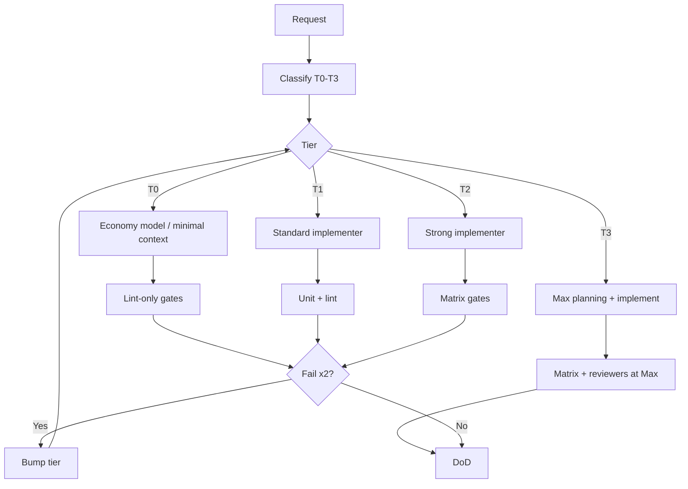

# Task Routing Workflow (tokens & models)

Run at the start of work (and when escalating).

## Flow

```
User request
    → Classify T0–T3 (ModelRoutingMatrix)
    → Announce routing line
    → Bind implementer model (or context budget if single model)
    → Load ≤N skills for tier
    → Implement + verify
    → Escalate tier if needed
    → Spawn T3 reviewers only when justified
    → DoD
```



## Reviewer rules

| Condition | Action |
|-----------|--------|
| Auth, PII, IAP, permissions | Security Reviewer @ **T3/max** |
| New module, boundary, cross-app design | Architecture Reviewer @ **T3/max** |
| T0 typo / pure style | **No** reviewers |
| T1 clear sibling bug | **No** Architecture Reviewer |

## Per-project config

Fill `project-context/MODEL_ROUTING.md` with real model names for Cursor/Claude/Codex.
